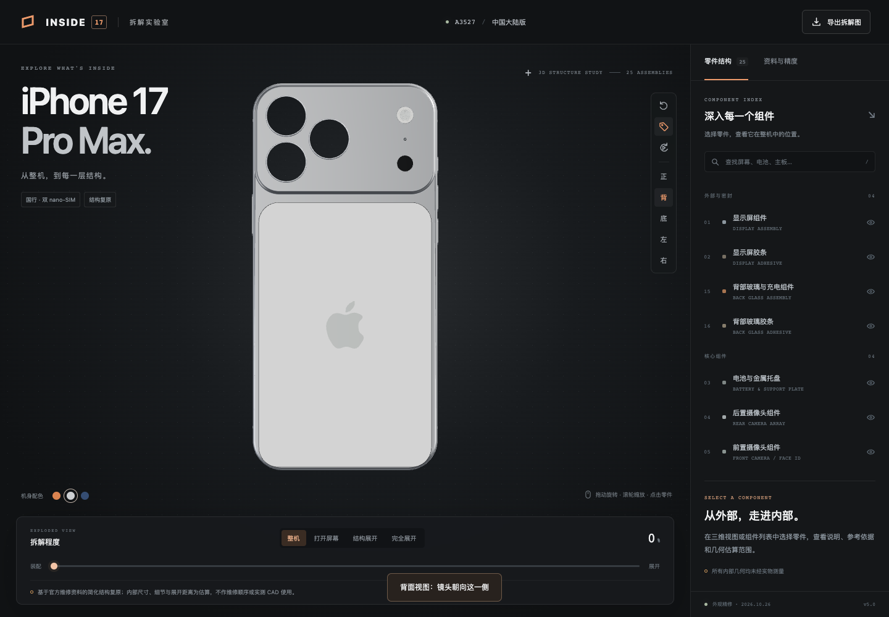

# Device Explode Studio

纯 Three.js 手机展示与拆解，v5.0。当前模型：iPhone 17 Pro Max A3527 国行双 nano-SIM，三色、25个组件。生成和运行无需 Blender、GLB 或 GLTFLoader。



## 运行

```sh
python3 scripts/serve.py
```

打开 http://127.0.0.1:4173/ 。所有运行资源本地打包，无需 npm 或 CDN。需现代 WebGL2 浏览器和本地 HTTP，不用 file://。

## 数据与修改

`dist/models/phone.scene.json.gz` 是 gzip 压缩的 Three.js Object3D JSON，`dist/load-model.js` 使用 ObjectLoader 读取。坐标已为毫米。它是从此前已验收模型迁移的网格快照，保留当前细节，不是参数化 CAD，也不是从零自动生成新机型。可以直接编辑解压的顶点/法线/材质/节点，或用 Three.js Shape、ExtrudeGeometry、LatheGeometry、BufferGeometry 重建新部件，保存 root.toJSON() 后再gzip压缩。

`dist/data/finish-palettes.json` 管理七类配色。支持展开、选择、隐藏、隔离、搜索、视图切换和PNG下载。

## Skill 和检查

复制 `skills/blender-threejs-phone-showcase` 到 `~/.codex/skills/`，调用 `$blender-threejs-phone-showcase`。名称为兼容旧调用保留，内容已改为原生 Three.js 工作流。

```sh
python3 skills/blender-threejs-phone-showcase/scripts/create_project.py --output /absolute/path/new-phone-project
npm install
npx playwright install chromium
npm run verify
```

生成器不会覆盖已有目录，输出中不含 .blend、.glb 或 Blender导出器。网页检查在 qa/ 生成报告和截图；用 --url / --out 指定位置，PLAYWRIGHT_MODULE 和 BROWSER_EXECUTABLE 可复用已安装环境。证据见 evidence/，其中 geometry.json 和旧 reproduction.json 为 v4.5 历史来源记录，当前原生路径验证以 native-reproduction.json 和 browser.json 为准。

## 许可与精度

项目代码及项目自建重建网格采用 MIT，见 LICENSE。Three.js许可位于 dist/vendor/THREE-LICENSE.txt。Apple标志、商标、产品设计和参考照片等第三方权利未随项目重新授权，见 THIRD_PARTY_NOTICES.md。内部几何、光学内部和板级元件仍为估算或视觉示意，非实测CAD。公开源码不等于发布网站。
